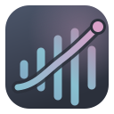
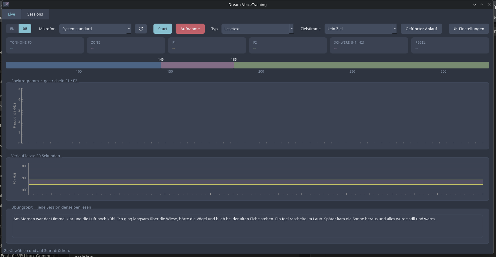
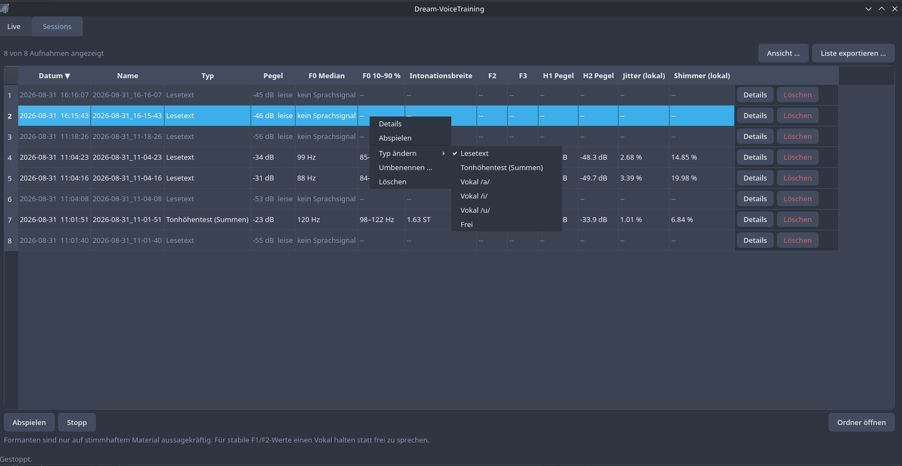
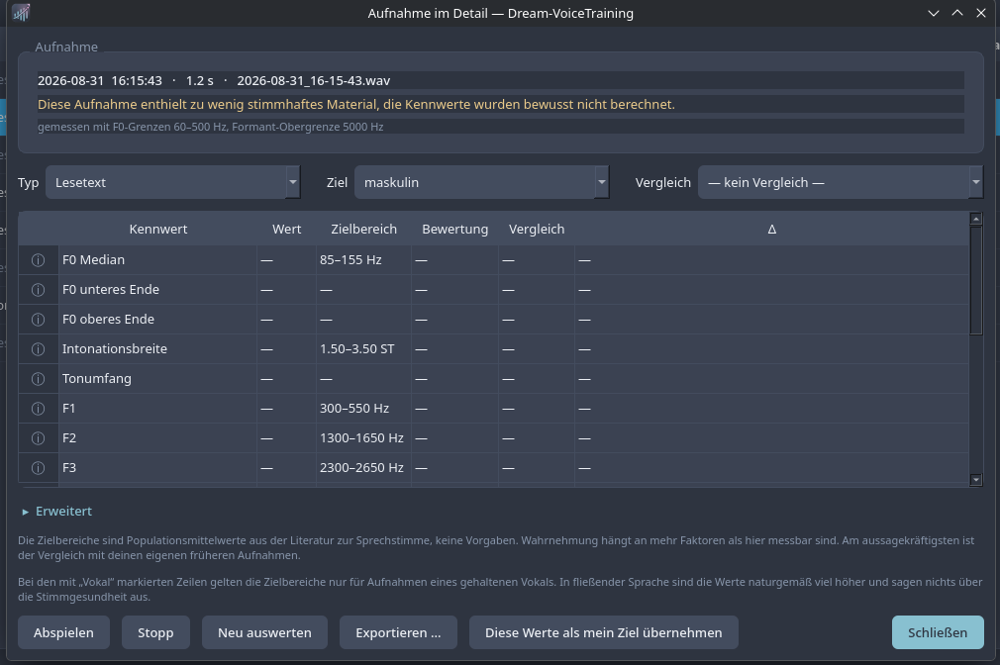

<div align="center">



# Dream-VoiceTraining

**Measure what your voice is actually doing — and watch it change over time.**

Pitch, resonance, weight, and voice quality — real-time analysis while you speak, tracked across sessions.

[](LICENSE)
[](THIRD_PARTY_NOTICES.md)


[Deutsch Version](README.de.md)

</div>

---
> [!NOTE]
> **Project status: feature-complete.** All core features are done and working. Development continues with bug fixes and maintenance — feature requests are welcome via [GitHub Issues](https://github.com/yakuda-stack/Dream-VoiceTraining/issues) or [Discord](https://discord.gg/ShNKvvZu74).


## ⚡ Quick Download & Installation

Native support for **Linux** and **Windows**. No setup required for portable versions.

| Platform | Quick Download / Command | Notes |
| :--- | :--- | :--- |
| **Linux (One-liner)** | `curl -fsSL https://raw.githubusercontent.com/yakuda-stack/Dream-VoiceTraining/main/install.sh \| bash` | Auto-installs on Arch, Ubuntu, Debian, Fedora, openSUSE |
| **Arch / CachyOS (AUR)** | `paru -S dream-voicetraining` | Official AUR package |
| **Linux (AppImage)** | [Download AppImage](https://github.com/yakuda-stack/Dream-VoiceTraining/releases/download/v1.2.0/Dream-VoiceTraining-1.2.0-x86_64.AppImage) | Single file execution (`chmod +x` & run) |
| **Windows (Installer)** | [Download Setup `.exe`](https://github.com/yakuda-stack/Dream-VoiceTraining/releases/download/v1.2.0/Dream-VoiceTraining-1.2.0.exe) | Sets itself up on first run: Start Menu and Desktop shortcuts, no admin rights, uninstall via Apps & Features |
| **Windows (Portable)** | [Download Portable `.exe`](https://github.com/yakuda-stack/Dream-VoiceTraining/releases/download/v1.2.0/Dream-VoiceTraining-1.2.0-Portable.exe) | Self-contained, stores data in local folder |
| **All Releases** | [GitHub Releases Overview](https://github.com/yakuda-stack/Dream-VoiceTraining/releases) | View all release history & full changelogs |

---

## 📸 Interface Overview

| Live Analysis | Session Management | Detailed Metrics |
| :---: | :---: | :---: |
|  |  |  |
| Real-time Pitch, Formants (F1/F2), & Weight | Track recordings over time across 25 sortable, exportable columns | 18 acoustic metrics & detailed spectrogram view |

---

## 🚀 Key Features

- **Real-Time Visual Analysis:** Pitch history, live spectrogram with F1/F2 formant tracking, pitch zone indicators, and voice weight (H1–H2).
- **Import Existing Recordings:** Bring in WAV files from anywhere on disk — 8, 16, 24 or 32-bit, mono or stereo — and analyse them alongside your live sessions. Files are copied, never moved.
- **Session History & Analytics:** Save recordings as WAV + JSON metrics. Filter, sort and export a table of 25 columns — 18 acoustic metrics, the in-target share, plus date, name, type and file.
- **Advanced Region Analysis & Spectrogram:** Select steady-state vowels (e.g., `/a/`, `/i/`, `/u/`) with a dedicated spectrogram view in the details panel for precise formant & jitter tracking.
- **Your Own Practice Texts & Recording Types:** Write and save practice texts of your own, and define recording types beyond the built-in ones — so the same material is measured the same way every session.
- **Progress Over Time:** Plot any value across all recordings, with a rolling average and the range of any target voice as a band.
- **In-Target Share:** See how much of a recording (and of the last 30 seconds live) stayed inside your target pitch range.
- **Compare Recordings:** Two to four takes side by side — every value with the change from oldest to newest, all playable.
- **Reference Recording:** Mark a take you like as reference and play it from the live view right before practising.
- **Streak & Break Reminder:** Days in a row with a recording, and a gentle reminder to rest after 20 minutes (adjustable).
- **Custom Target Profiles:** Compare your measurements against Masculine, Androgynous, Feminine, or custom reference ranges.
- **Update Notice:** The version number at the bottom right turns yellow when a new release is out — one click shows what is new and the right download.
- **Private by Design:** Follows XDG specs. No tracking, no telemetry, no cloud dependency. Network requests only for the update check if you allow it (asked once) and for the changelog.

**Languages:** English and German built in. Every file in [`locales/`](locales) appears in the language dropdown — copy `en.json`, set `"lang"` and `"name"` at the top and translate. Missing texts fall back to English. Own files can also go into `~/.config/dream-voicetraining/locales/`.

*(Want to know what the numbers mean and how they are measured? See the [Acoustic Metrics & Methodology guide](docs/metrics.md).)*

---

## ⚠️ Important Disclaimer

> **Dream-VoiceTraining is a measuring instrument, not a therapy program or medical device.**

1. **Never train through pain:** Stop immediately if you feel strain, scratching, or hoarseness.
2. **Numbers are orientation, not a grade:** Vocal perception depends on far more factors than physical acoustic metrics alone.
3. **Professional guidance beats software:** A few sessions with a speech-language pathologist (SLP) save hundreds of hours of trial and error.

---

<details>
<summary><b>🛠️ Building from Source & Advanced Installation</b></summary>

### Linux (Manual / Source)
Ensure `portaudio` is installed on your system:
```bash
# System dependency (PortAudio)
sudo pacman -S portaudio                        # Arch / CachyOS
sudo apt install libportaudio2 libpulse0        # Debian / Ubuntu / Mint

# Build & Run
python -m venv .venv
source .venv/bin/activate
pip install -r requirements-dev.txt
python main.py
```

### Windows (Manual PowerShell Build)
```powershell
powershell -ExecutionPolicy Bypass -File packaging\windows\build_windows.ps1
```
Creates portable and installer executables inside `dist/`.

</details>

<details>
<summary><b>📂 Data & File Management</b></summary>

Files follow standard OS paths:
* **Linux:** `~/.config/dream-voicetraining/` (settings) and `~/.local/share/dream-voicetraining/sessions/` (recordings).
* **Windows:** `%APPDATA%\Dream-VoiceTraining\` (settings) and `%LOCALAPPDATA%\Dream-VoiceTraining\` (recordings).

Custom file naming schemes and target folders can be configured in **Settings → Options**.

</details>

---


### Development Approach
AI tools were used extensively to accelerate development and code generation. System architecture, feature decisions, code reviews, and quality control were managed directly by the developer. All code is tested and verified prior to release.

---

## 💬 Community & Support

* **Discord:** [Join Community Server](https://discord.gg/ShNKvvZu74)
* **Ko-fi:** [Support on Ko-fi](https://ko-fi.com/yakuda_) *(Optional — software is free and open-source)*
* **What's new:** [Changelog](CHANGELOG.md) | [Highlights](HIGHLIGHTS.md)
* **License:** [GPL v3](LICENSE) | [Third-Party Notices](THIRD_PARTY_NOTICES.md)

---

<p align="center"><sub>🤖 <b>Transparency note:</b> This project and its documentation are developed with the support of AI coding assistants (<b>Claude by Anthropic</b>). <b>Idea, architecture &amp; UX/UI design:</b> by me. The controls code comes from Yakuda Connect.</sub></p>
<p align="center"><sub>Licensed under GPL-3.0</sub></p>